# CAPÍTULO IV: SOSTENIBILIDAD, PROPUESTA DE VALOR, CONSOLIDACIÓN DEL MVP Y TECNOLOGÍAS USADAS

## 4.1 Sostenibilidad del proyecto

Para que una plataforma escolar como Shidell no quede únicamente como un prototipo de curso universitario, resulta necesario analizar si la institución educativa puede sostener su funcionamiento año tras año sin depender de presupuestos altos ni de un equipo de soporte dedicado a tiempo completo. El análisis se divide en cuatro frentes concretos: técnico, económico, operativo y socioambiental.

### 4.1.1 Sostenibilidad técnica y mantenibilidad

Al diseñar la aplicación se evitó construir una estructura compleja difícil de mantener por un equipo pequeño. El backend está organizado en Spring Boot siguiendo una separación tradicional por capas: dieciséis controladores web para atender las rutas HTTP, servicios donde residen las reglas de negocio académicas, repositorios JPA para las consultas, un mapeador dedicado (`EntityMapper`) y utilitarios propios para fechas lectivas y carga de archivos. Gracias a esto, si el Ministerio de Educación modifica la duración de un bimestre o el criterio de evaluación, el cambio se realiza en las clases de calendario o cálculo sin tocar las tablas ni las pantallas del navegador.

Un punto que suele complicar la evolución de los sistemas escolares es el crecimiento de la carga en fechas críticas, como el cierre de notas o las matrículas. En lugar de desplegar desde el primer día cuatro servidores separados que consumirían memoria innecesaria, Shidell opera de manera consolidada pero cuenta con un servidor de descubrimiento Netflix Eureka (`shidell-eureka-server` en el puerto `8761`) y con un diseño modular documentado en el repositorio (`propuesta_arquitectura_microservicios.md`). Si en el futuro el plantel crece o decide separar el módulo de mensajería y el de evaluaciones, el paso hacia servicios independientes ya tiene base técnica definida.

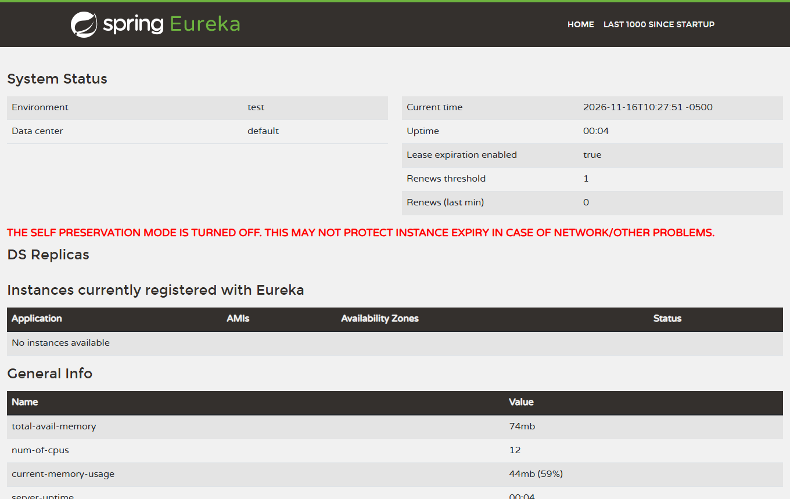

**Figura 4.1.** *Instancia de Netflix Eureka en ejecución (`:8761`), preparada para registrar futuros servicios desacoplados.*

En cuanto al rendimiento interno, durante las primeras pruebas de navegación se detectaron cuellos de botella concretos: cada vez que un usuario cambiaba de vista en el navegador, la interfaz volvía a pedir la configuración institucional (`/api/config`), el perfil autenticado o el catálogo de cursos, y un filtro HTTP bloqueaba por completo la caché con `no-store`. Para corregir ese comportamiento sin perder seguridad, se ajustó el pool HikariCP a un máximo de 10 conexiones activas (con 4 en espera y `open-in-view=false`), se activó batching JDBC (`jdbc.batch_size=25`), compresión GZIP y caché en memoria RAM mediante Caffeine (`CacheConfig`) acompañada de etiquetas `ETag` (`304 Not Modified`). En el navegador, además, se incorporó carga anticipada de enlaces al pasar el cursor (`ShidellSpeed`) y pausa automática de consultas periódicas cuando la pestaña queda oculta.

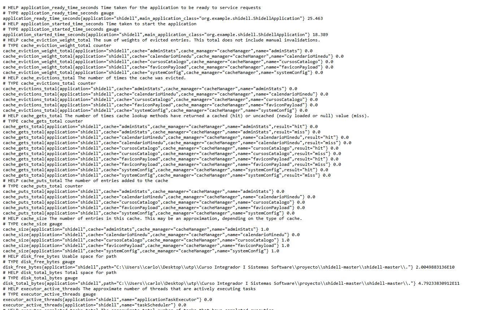

**Figura 4.2.** *Salida real de `/actuator/prometheus` mostrando los cachés Caffeine (`adminStats`, `calendarioMinedu`, `cursosCatalogo`, `faviconPayload` y `systemConfig`).*

La permanencia técnica se respalda también en la documentación de la base de datos PostgreSQL (`demo1`). El esquema completo se encuentra exportado en `docs/database/schema.sql` junto con la guía `BASE_DE_DATOS.md`, y la aplicación posee inicializadores idempotentes (`DataSeeder` y `AcademicCurriculumInitializer`) capaces de poblar aulas, horarios, matrículas y las 36 semanas lectivas desde cero si se instala en un servidor nuevo. Para evitar fallos al actualizar el código, el proyecto incluye 30 archivos de prueba automatizados con 162 verificaciones en JUnit 5, Mockito y H2 en memoria, además de recolección de métricas hacia Prometheus y Grafana mediante Docker Compose.

### 4.1.2 Sostenibilidad económica

El entorno de referencia levantado en `demo1` simula una institución escolar completa con 39 aulas (24 secciones de primaria en turno mañana y 15 de secundaria en turno tarde), 391 estudiantes matriculados y 81 docentes. Sostener un sistema comercial externo para cerca de cuatrocientos alumnos suele implicar pagos por licencia de usuario o contratos anuales elevados en dólares, lo cual dificulta su continuidad en colegios privados de pensión accesible o centros parroquiales.

Shidell elimina por completo el gasto en licencias de software porque todo su núcleo corre sobre tecnologías abiertas: Java 22, Spring Boot 3.3.0, PostgreSQL 18, Caffeine, FullCalendar, ApexCharts, Chart.js, Prometheus y Grafana tienen costo cero de licenciamiento.

Desde el lado del alojamiento, el consumo optimizado de conexiones (`pool=10`) y el almacenamiento en memoria de las consultas repetitivas permiten operar la aplicación en un servidor físico dentro del propio colegio o en un servidor privado virtual (VPS) básico de cuatro núcleos y 8 GB de RAM. En un esquema de comercialización institucional B2B, el colegio puede cubrir ese alojamiento mensual junto con el dominio, el certificado SSL y las copias de seguridad automáticas (`pg_dump`) mediante una cuota anual accesible o un monto bajo incluido dentro del servicio administrativo del ciclo escolar. A esto se suma el ahorro material del plantel al dejar de imprimir circulares semanales, libretas bimestrales, listas en papel y constancias físicas de entrega.

### 4.1.3 Sostenibilidad operativa e institucional

Un programa escolar deja de usarse cuando resulta confuso para quienes no tienen formación informática. Durante las pruebas previas descritas en el Capítulo III con 16 participantes entre alumnos, profesores, padres y coordinación académica, el sistema obtuvo un puntaje de 84.5 sobre 100 en la escala SUS, lo cual confirmó que el flujo principal se entiende sin capacitaciones extensas.

Sin embargo, en la operación cotidiana suelen aparecer imprevistos fuera del código ideal: enlaces rotos, caídas temporales de internet, errores al subir un archivo muy pesado o profesores que olvidaron tomar lista dentro de la hora exacta de clase. Para evitar que esos incidentes generen llamadas constantes a soporte técnico o frustración en las familias, se trabajaron dos aspectos prácticos. Primero, desde el panel administrativo se permite regularizar asistencias del día o fechas pasadas sin necesidad de abrir permisos a destiempo a los docentes ni editar manualmente la base de datos, manteniendo el modelo disperso de asistencia donde el alumno figura presente por defecto en los días hábiles del calendario MINEDU 2026.

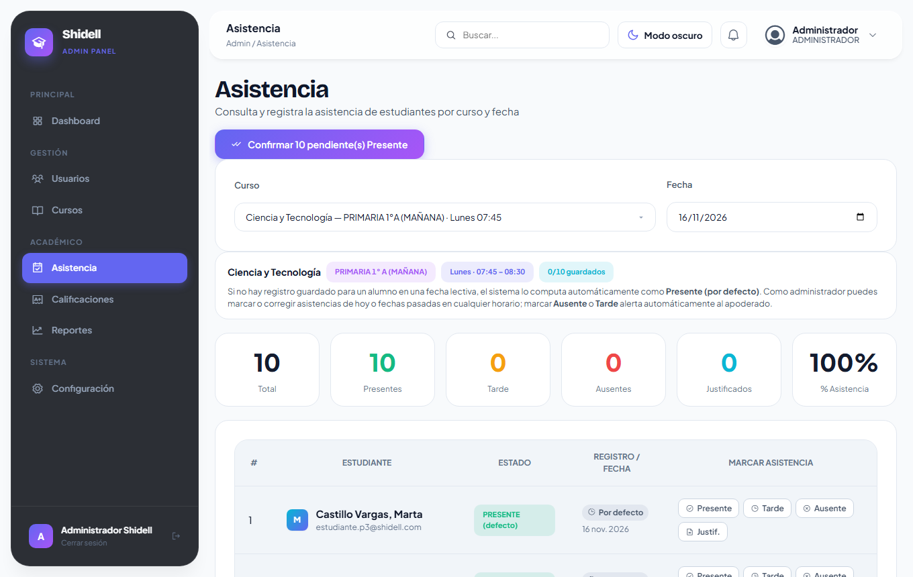

**Figura 4.3.** *Módulo de asistencia en Administración mostrando el cómputo automático por defecto (`PRESENTE`) y el control manual autorizado.*

Segundo, la dirección o el personal administrativo pueden cambiar el nombre de la institución en las pestañas del navegador y subir su propio escudo o favicon desde la interfaz web (`SystemConfig`) sin pedir cambios de código ni recompilar el proyecto.

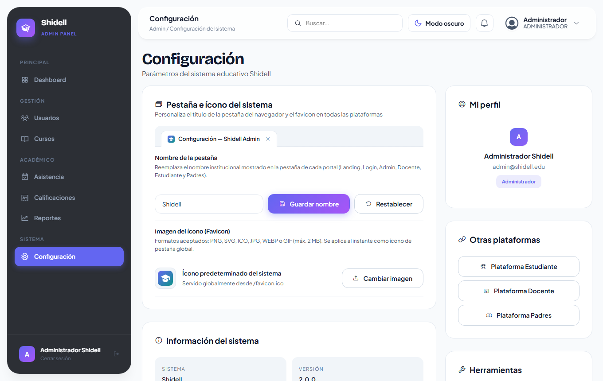

**Figura 4.4.** *Editor de marca institucional que propaga título e ícono en todos los portales del colegio.*

Finalmente, se suprimieron los mensajes técnicos del tipo `HTTP error 500`, `SQLGrammarException` o avisos sobre el servidor backend tanto en `GlobalExceptionHandler` como en el frontend (`ShidellErrors`). Cuando ocurre algún problema, el estudiante, docente, apoderado o administrador ve un aviso redactado en lenguaje sencillo acompañado de una ilustración propia de su plataforma, botones claros para reintentar o volver a su inicio, y un bloque pequeño e interactivo de datos curiosos educativos que hace menos tensa la espera o el error.

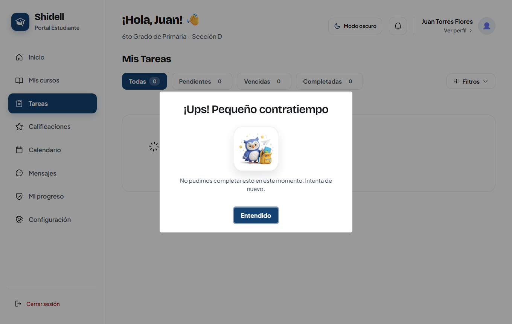

**Figura 4.5.** *Traducción amigable ante un error simulado (`HTTP 500` / `SQLGrammarException`), sin mostrar trazas técnicas al escolar.*

### 4.1.4 Sostenibilidad social y ambiental

En el plano social, la plataforma reduce la brecha de comunicación entre la escuela y el hogar. Muchos apoderados trabajan en horarios que les impiden acercarse al colegio entre semana; contar con alertas automáticas cuando se marca una tardanza o inasistencia, sumado a la mensajería directa con los profesores donde se distingue quién está conectado en ese momento (`En línea`, `Ausente` o `Desconectado`), permite intervenir antes de que termine el bimestre. Al tratarse de una aplicación web ligera con soporte de manifiesto PWA (`manifest.json`), las familias ingresan desde el navegador de su teléfono sin verse obligadas a comprar equipos nuevos ni descargar aplicaciones pesadas.

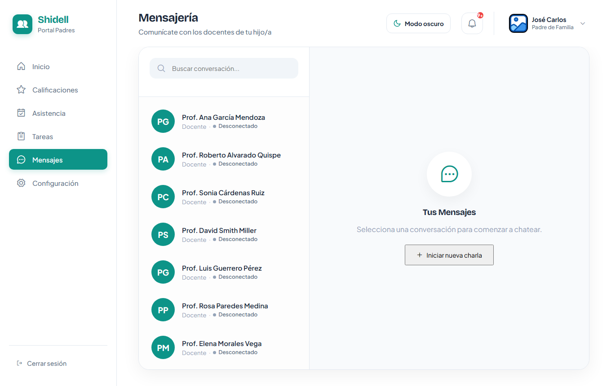

**Figura 4.6.** *Portal Padres mostrando el listado real de docentes y su estado de disponibilidad.*

En el aspecto ambiental, digitalizar el trabajo semanal de 391 alumnos distribuidos en 39 aulas durante 36 semanas lectivas implica evitar miles de hojas impresas en guías, cargos físicos de recepción, citaciones y reportes bimestrales, disminuyendo también el consumo de tinta y el traslado físico frecuente de los padres solo para revisar avances.

---

## 4.2 Propuesta de valor con Lean Canvas

Para ordenar el modelo operativo de Shidell frente a la realidad de los colegios peruanos de educación básica, se aplicó la herramienta **Lean Canvas** estructurada en sus nueve bloques:

| Bloque | Definición aplicada al proyecto Shidell |
| :--- | :--- |
| **1. Segmentos de clientes** | Colegios privados y parroquiales de primaria y secundaria en Perú (rango objetivo inicial de 250 a 600 estudiantes, similar a las 39 aulas modeladas) que aún gestionan tareas por WhatsApp o Excel. Los usuarios directos son estudiantes, docentes, padres de familia y coordinación académica. |
| **2. Problemas** | 1. Tareas y fotos enviadas por mensajería informal que se pierden sin comprobante ni hora verificable. 2. Padres de familia que recién se enteran de faltas o bajas notas al cierre del bimestre. 3. Carga operativa docente para ordenar actividades de 36 semanas, registrar asistencias y consolidar notas bimestrales. |
| **3. Propuesta de valor única** | Plataforma académica escolar adaptada al calendario peruano: orden semanal claro, constancia formal en cada entrega de tarea, aviso inmediato a las familias y mensajes comprensibles sin lenguaje técnico. |
| **4. Solución** | Organización curricular automática en 4 bimestres (36 semanas y 8 exámenes formales por curso), cargo digital por entrega, toma de asistencia con regla hábil MINEDU y regularización administrativa, portal móvil para padres y cuatro entornos diseñados según cada perfil. |
| **5. Canales** | Demostraciones directas con promotores y directores escolares, recomendaciones entre instituciones vecinas y acceso web multiplataforma sin instalación obligatoria. |
| **6. Flujos de ingresos** | Suscripción institucional anual o mensual según tamaño del alumnado, paquete inicial de migración de nómina e inducción docente, y soporte técnico opcional con copias de respaldo en la nube. |
| **7. Estructura de costos** | Costo cero por licencias de software. Gasto concentrado en alquiler de servidor VPS o mantenimiento de servidor local, dominio, certificado SSL, horas de soporte y respaldo de base de datos. |
| **8. Métricas clave** | Porcentaje de docentes que registran lista y notas dentro del sistema cada semana, proporción de tareas entregadas con constancia digital, frecuencia de lectura de avisos por apoderados, puntaje de usabilidad (SUS >= 80) y latencia HTTP medida en Prometheus. |
| **9. Ventaja injusta** | Reglas de negocio ajustadas nativamente al año escolar peruano (4 bimestres, feriados nacionales, turnos mañana y tarde, escala vigesimal/CNEB) en una base propia sin licencias por usuario, frente a plataformas extranjeras genéricas que requieren adaptaciones manuales. |

A diferencia de soluciones pensadas para universidades extranjeras, el valor principal del sistema radica en hablarle en términos cotidianos a un alumno de primaria, a un docente con carga horaria completa y a un padre que revisa el celular desde el trabajo.

---

## 4.3 Consolidación del MVP

El Producto Mínimo Viable dejó de ser una maqueta estática para funcionar como un sistema conectado de punta a punta con persistencia real en PostgreSQL, autenticación firmada y cuatro portales diferenciados.

En el **Portal Administrativo** (`/plataformaadmin/`) se centralizó la supervisión general de los 391 estudiantes, 81 profesores, 4 cuentas de padres de prueba y 39 aulas, junto con el módulo de asistencia con permiso de corrección histórica, el clonado de cursos sin cruces horarios y la edición global del nombre e ícono de pestaña.

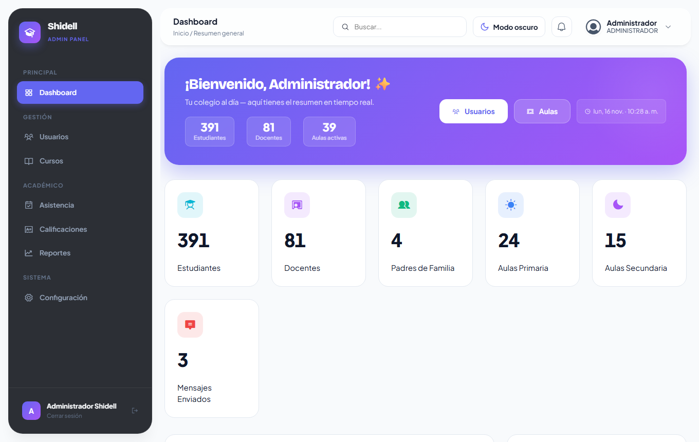

**Figura 4.7.** *Resumen administrativo en vivo mostrando alumnos, docentes, apoderados y aulas de primaria y secundaria.*

En el **Portal del Estudiante** (`/plataformaestudiante/`) quedaron operativos el tablero principal con indicadores de cursos, tareas pendientes, horas semanales y promedio acumulado, el detalle semanal de cursos, la entrega de archivos con cargo digital, las calificaciones, el calendario con recordatorios propios y el chat.

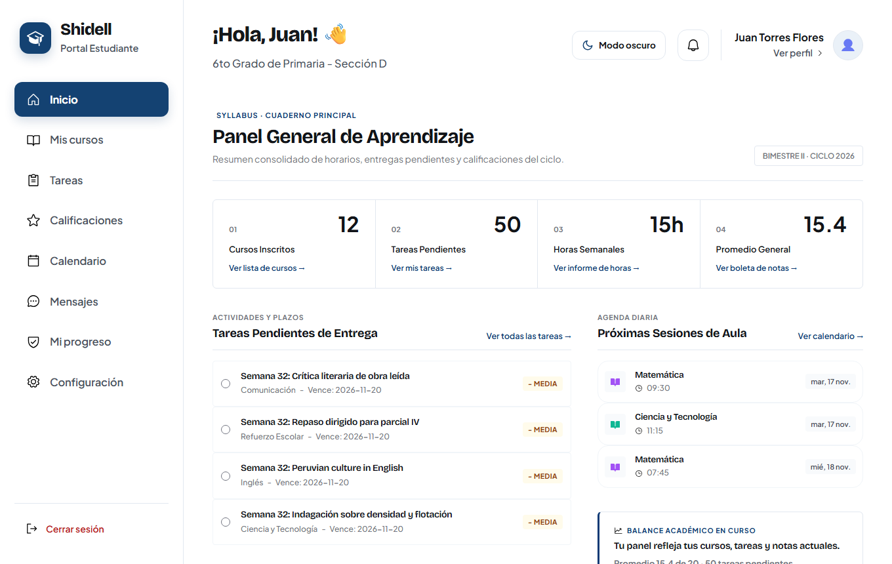

**Figura 4.8.** *Vista principal del estudiante (`6to Grado de Primaria - Sección D`) con datos reales cargados desde PostgreSQL.*

En el **Portal Docente** (`/plataformadocente/`) se consolidó una aplicación de página única con modo oscuro (*Obsidian Scholar*) y modo claro donde cada profesor visualiza sus salones asignados, registra asistencia en su horario de clase, crea evaluaciones o tareas semanales, modera foros y califica entregas por lote.

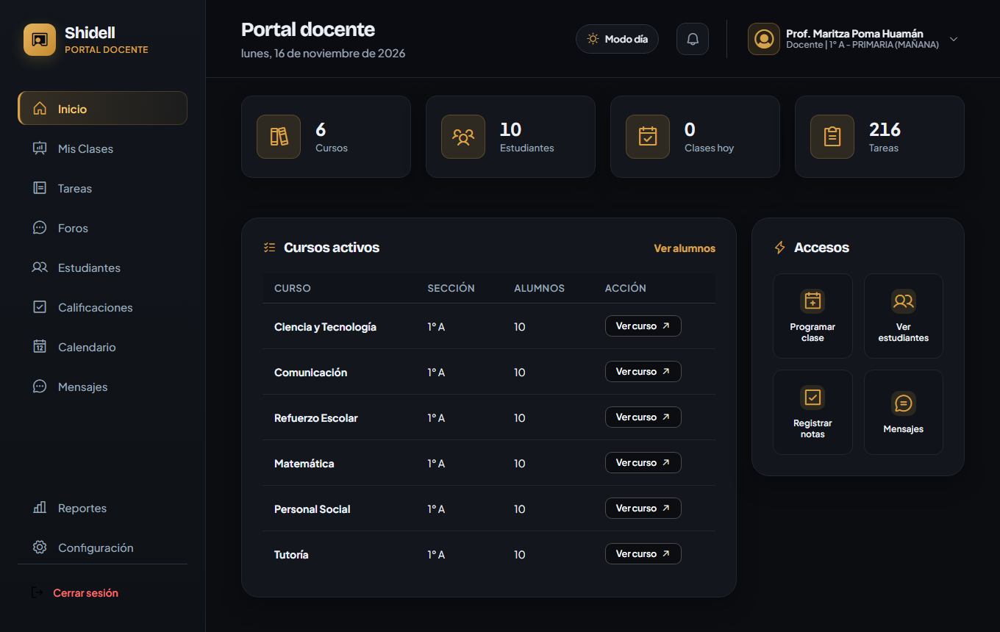

**Figura 4.9.** *Entorno docente mostrando los 6 cursos activos de `1° A - Primaria (Mañana)` y su alumnado matriculado.*

Como parte del cierre y pulido final del MVP, se estandarizó el tratamiento de errores visuales en los cuatro portales mediante páginas dedicadas (`403.html`, `404.html`, `500.html`, `error.html`) e ilustraciones diseñadas para cada perfil (un búho escolar para Estudiantes, escritorio dorado para Docentes, ave origami para Familias y bloques isométricos para Administración), complementadas con navegación rápida por teclado (`Ctrl+K`) y micro-celebraciones discretas al completar tareas o guardar registros.

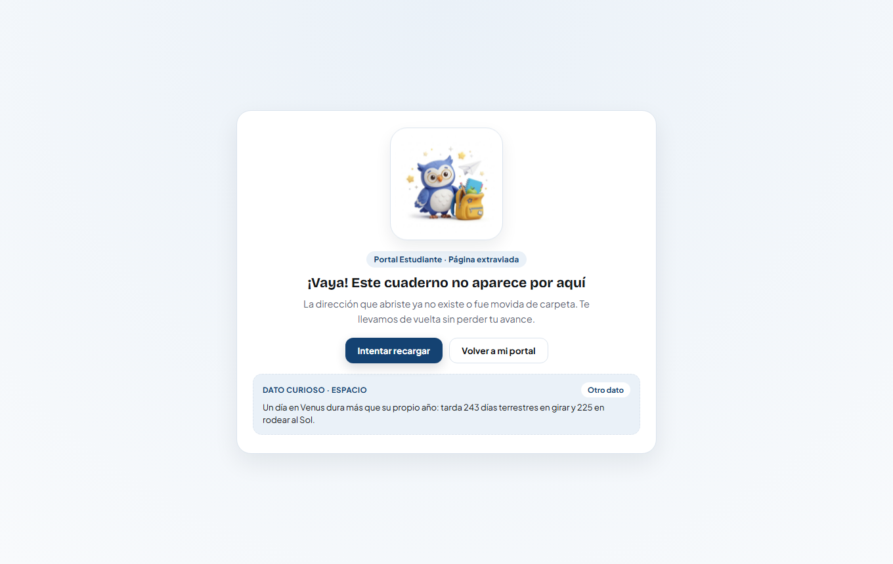

**Figura 4.10.** *Pantalla `404` personalizada para Estudiantes ante una ruta inexistente, con tono amable y botón de regreso directo.*

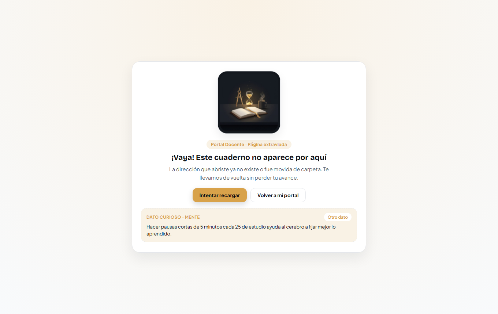

**Figura 4.11.** *Vista de página no encontrada para Docentes con su ilustración temática y bloque recreativo educativo.*

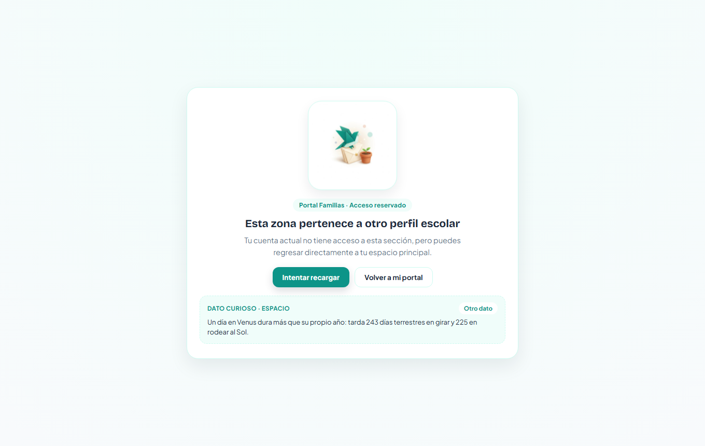

**Figura 4.12.** *Aviso de acceso restringido adaptado a la paleta verde azulado del Portal Padres.*

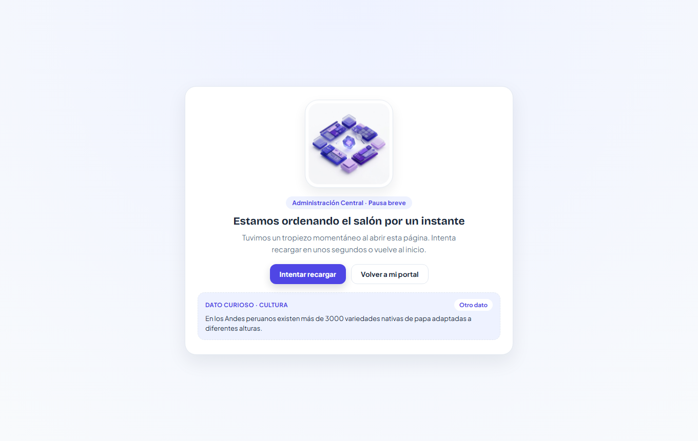

**Figura 4.13.** *Pantalla amigable ante pausas temporales en Administración.*

En cifras verificadas sobre el repositorio actual, la base de datos `demo1` reúne 16 tablas y 26 claves foráneas con más de 22 600 registros generados de manera automática (`478` usuarios, `1 536` bloques de curso, `14 580` tareas semanales y `3 243` evaluaciones). A nivel de software, todas las suites de prueba compilan y aprueban (`Tests run: 162, Failures: 0, Errors: 0, Skipped: 0` en 30 archivos de test), y las capturas anteriores fueron tomadas en Chrome sin errores JavaScript en consola.

---

## 4.4 Detalle de tecnologías usadas

El proyecto combinó herramientas estables de código abierto en el servidor con tecnologías web estándar en el cliente para evitar compilaciones pesadas en el frontend. En el servidor se utilizó **Java 22** sobre **Spring Boot 3.3.0**, apoyado en Spring Web, Spring Data JPA con Hibernate, Spring Cache y Spring Actuator. La gestión de dependencias se realiza con **Apache Maven**, mientras que **Spring Cloud 2023.0.3 (Netflix Eureka Server)** provee el registro de servicios en un módulo independiente.

La capa de datos emplea **PostgreSQL 18.0** junto con **HikariCP** para controlar el grupo de conexiones, y **Caffeine 3.1.8** más `ShallowEtagHeaderFilter` para servir desde memoria los datos consultados con mayor frecuencia. En las pruebas automáticas se usa **H2 Database** en memoria para aislar los tests de la base real. En seguridad, [`AuthSessionService`](../../src/main/java/org/example/shidell/service/AuthSessionService.java) genera tokens firmados con `HmacSHA256` válidos por ocho horas y hashes `SHA-256` para contraseñas, validados en cada petición por [`AuthInterceptor`](../../src/main/java/org/example/shidell/config/AuthInterceptor.java) junto con cabeceras OWASP (`X-Frame-Options: DENY`, `X-Content-Type-Options: nosniff`, `HttpOnly` y `SameSite=Lax`).

En el navegador se trabajó con **HTML5, CSS3 modular y JavaScript ES6+** sin frameworks pesados, acompañados de soporte PWA básico (`manifest.json` y `sw.js`). Para tareas específicas de interfaz se integraron librerías concretas: **FullCalendar 7.1.5** para agendas escolares, **ApexCharts 8.3.1** y **Chart.js** para gráficos de rendimiento, **SweetAlert2 v11** para diálogos confirmatorios y avisos amigables, **jsPDF** para comprobantes, **SortableJS 1.15.7**, **Animate.css 4.1.1**, **Canvas Confetti 1.9.4** y los iconos SVG de **Phosphor Icons 2.1.1**, además de tipografías Google Fonts (`Bricolage Grotesque`, `Plus Jakarta Sans` y `JetBrains Mono`). El comportamiento transversal de temas, presencia en línea, animaciones y mensajes amigables reside en los módulos propios `shidell-theme.js`, `shidell-presence.js`, `shidell-motion.js` y `shidell-ux.js`. Finalmente, la observabilidad se cubre con **Micrometer Prometheus** conectado a **Prometheus y Grafana** mediante Docker Compose, y las verificaciones automáticas descansan sobre **JUnit 5, Mockito, MockMvc y Chrome/Puppeteer**.

| Capa del sistema | Tecnología o librería | Versión / Parámetro en proyecto | Responsabilidad en Shidell |
| :--- | :--- | :--- | :--- |
| Lenguaje y runtime | Java JDK | Compilación `22` / JVM `25.0.1` | Lógica backend, concurrencia y seguridad |
| Framework principal | Spring Boot | `3.3.0` (`web`, `data-jpa`, `actuator`, `cache`) | API REST, MVC, inyección y servidor Tomcat |
| Descubrimiento | Spring Cloud Netflix Eureka | `2023.0.3` (`:8761`) | Registro de nodos para futura separación en servicios |
| Base de datos | PostgreSQL | `18.0` (`demo1`) | Persistencia relacional de las 16 tablas escolares |
| Persistencia y pool | Hibernate JPA + HikariCP | `pool=10`, `batch_size=25`, `open-in-view=false` | Mapeo ORM, inserciones por lote y control de conexiones |
| Caché y red | Caffeine + ShallowEtagHeaderFilter | `Caffeine 3.1.8` + GZIP HTTP | Caché en RAM (`systemConfig`, `adminStats`, cursos) y HTTP `304` |
| Seguridad | HMAC-SHA256 + SHA-256 + Filtro | Tokens de `8 h` + cabeceras OWASP | Autenticación, control por roles y protección de vistas |
| Interfaz web | HTML5, CSS3, JavaScript ES6+, PWA | `manifest.json` + `sw.js` | Cuatro portales responsivos con tema claro y oscuro |
| Librerías UI | FullCalendar, ApexCharts, Chart.js, SweetAlert2, jsPDF, SortableJS, Phosphor Icons | `7.1.5`, `8.3.1`, `v11`, `1.15.7`, `2.1.1` | Calendarios, gráficos, avisos ilustrados, PDFs e iconografía |
| Módulos UX propios | `shidell-ux.js`, `shidell-theme.js`, `shidell-motion.js`, `shidell-presence.js` | `/static/vendor/` | Errores humanos con ilustración, prefetch, presencia y `Ctrl+K` |
| Monitoreo | Micrometer + Prometheus + Grafana | `docker-compose.yml` (`:9090`, `:3000`) | Métricas JVM, cachés y conexiones HikariCP |
| Pruebas y build | JUnit 5, Mockito, H2, Puppeteer, Maven, npm | `162` pruebas Maven + E2E Chrome | Validación unitaria, web, seguridad OWASP y capturas visuales |
