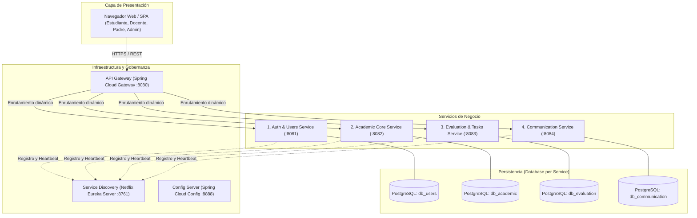
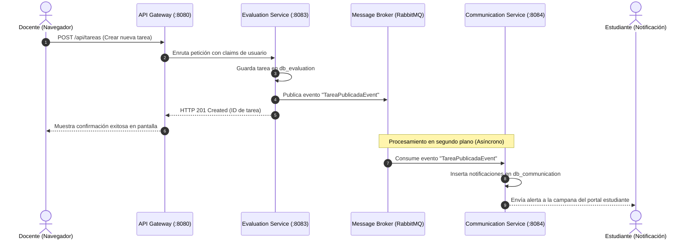

# Propuesta de Arquitectura Basada en Microservicios: Plataforma Shidell

**Proyecto:** Shidell - Plataforma de Gestión Académica Escolar  
**Curso:** Curso Integrador I: Sistemas - Software  
**Tipo de Documento:** Especificación y Diseño Arquitectónico de Software  

---

## 1. Justificación Técnica del Cambio Arquitectónico

Actualmente, Shidell opera bajo un **Monolito en Capas (Layered Monolithic Architecture)** sobre Spring Boot y PostgreSQL. Si bien esta arquitectura es eficiente para la etapa inicial y el prototipado (MVP), el crecimiento proyectado de la institución educativa plantea los siguientes desafíos que justifican la transición hacia **Microservicios**:

1. **Picos de carga asimétricos:** Procesos como el periodo de matrículas a inicio de año o el cierre de bimestres (subida masiva de calificaciones y entregas de tareas) generan una alta demanda en módulos específicos. En un monolito, escalar implica replicar todo el sistema (incluyendo módulos inactivos), mientras que en microservicios se escala horizontalmente únicamente el servicio saturado.
2. **Aislamiento de fallos (Fault Isolation):** Una saturación o excepción no controlada en el procesamiento de archivos pesados o generación de reportes no debe comprometer la disponibilidad del módulo de autenticación o la consulta de horarios.
3. **Despliegues independientes (CI/CD):** Permite que el equipo libere mejoras en el portal de padres o en el sistema de mensajería sin requerir un reinicio total de la infraestructura escolar.

---

## 2. Descomposición por Dominios (Domain-Driven Design - DDD)

Aplicando el principio de **Contextos Delimitados (Bounded Contexts)**, las 14 entidades actuales del sistema se distribuyen en **cuatro microservicios de negocio** y **tres componentes de infraestructura**:

---

## 3. Especificación de los Microservicios

### 3.1. Auth & Identity Service (`shidell-auth-service`)
* **Responsabilidad:** Gestión centralizada de identidad, perfiles de usuario, roles institucionales y emisión/validación de tokens de sesión (JWT).
* **Entidades asignadas:** `UserEntity`, roles institucionales (Administrador, Docente, Estudiante, Padre).
* **Endpoints Principales:**
  * `POST /api/auth/login` (Autenticación y generación de JWT)
  * `POST /api/auth/register` (Alta de usuarios)
  * `GET /api/users/{id}` (Consulta de perfil)
  * `PUT /api/users/{id}/foto-perfil` (Actualización de avatar)
* **Base de Datos:** `db_shidell_users` (PostgreSQL).

### 3.2. Academic Core Service (`shidell-academic-service`)
* **Responsabilidad:** Gestión de la estructura escolar, malla curricular del MINEDU, asignación de aulas, secciones, turnos y programación de horarios.
* **Entidades asignadas:** `Aula`, `Curso`, `Matricula`, `Horario`.
* **Endpoints Principales:**
  * `GET /api/cursos/estudiante/{id}` (Cursos en los que un alumno está matriculado)
  * `GET /api/cursos/docente/{id}` (Cursos a cargo de un docente)
  * `GET /api/horarios/aula/{aulaId}` (Malla horaria semanal por sección)
  * `POST /api/matriculas` (Asignación de estudiante a un aula y año lectivo)
* **Base de Datos:** `db_shidell_academic` (PostgreSQL).

### 3.3. Evaluation & Tasks Service (`shidell-evaluation-service`)
* **Responsabilidad:** Ciclo de vida de actividades académicas: creación de tareas por docentes, entrega de evidencias por estudiantes, registro de calificaciones bimestrales y control de asistencias.
* **Entidades asignadas:** `Tarea`, `Entrega`, `Calificacion`, `Asistencia`.
* **Endpoints Principales:**
  * `GET /api/tareas/estudiante/{id}` (Listado de pendientes y completadas)
  * `POST /api/tareas` (Publicación de nueva asignación docente)
  * `POST /api/entregas` (Recepción de soluciones en PDF/documentos)
  * `POST /api/calificaciones` (Registro de notas cuantitativas y cualitativas)
* **Base de Datos:** `db_shidell_evaluation` (PostgreSQL).

### 3.4. Communication & Notification Service (`shidell-communication-service`)
* **Responsabilidad:** Canal de comunicación bidireccional entre la comunidad educativa (docentes, estudiantes y padres), foros temáticos por semana y envío de alertas del sistema.
* **Entidades asignadas:** `Mensaje`, `Notificacion`, `ForoSemanaMensaje`, `Evento`.
* **Endpoints Principales:**
  * `GET /api/mensajes/conversacion` (Historial de chat entre dos usuarios)
  * `POST /api/mensajes` (Envío de mensaje directo)
  * `GET /api/notificaciones/usuario/{id}` (Bandeja de alertas no leídas)
  * `GET /api/foros/curso/{cursoId}/semana/{num}` (Hilos de debate de clase)
* **Base de Datos:** `db_shidell_communication` (PostgreSQL).

---

## 4. Componentes de Infraestructura y Comunicación

### 4.1. API Gateway (Spring Cloud Gateway)
* Actúa como **puerto de entrada único (Single Entry Point)** para el cliente web.
* **Funciones:**
  * Enrutamiento perimetral: Redirige `/api/auth/**` hacia el puerto 8081, `/api/cursos/**` al 8082, etc.
  * Validación centralizada de JWT: Descarga a los microservicios internos de verificar firmas criptográficas en cada llamada redundante.
  * Rate Limiting y CORS centralizado.

### 4.2. Service Discovery (Netflix Eureka)
* Evita el cableado estático de direcciones IP y puertos.
* Si el servicio `shidell-evaluation-service` se replica en dos instancias (`:8083` y `:8085`), Eureka distribuye la carga de forma automática mediante Round Robin integrado con Spring Cloud LoadBalancer.

### 4.3. Comunicación entre Servicios
1. **Sincrónica (Spring Cloud OpenFeign + Resilience4j):**
   * Empleada para consultas puntuales de solo lectura donde el cliente requiere respuesta inmediata.
   * *Ejemplo:* Cuando `Evaluation Service` necesita verificar si un `estudianteId` existe antes de registrar una entrega, invoca al `Auth Service` mediante Feign. Se añade un Circuit Breaker con Resilience4j para retornar una respuesta degradada si el servicio de usuarios no responde en menos de 1.5 segundos.
2. **Asíncrona (RabbitMQ / Apache Kafka):**
   * Empleada para eventos de negocio desacoplados.
   * *Ejemplo:* Cuando un docente publica una tarea en `Evaluation Service`, se emite un evento `TareaCreadaEvent` a un bus de mensajería. `Communication Service` consume el evento y genera automáticamente las notificaciones para todos los estudiantes matriculados, sin bloquear al docente.

---

## 5. Estrategia de Persistencia y Desacoplamiento (Database-per-Service)

El reto crítico al pasar del monolito a microservicios es la **eliminación de Foreign Keys directas en base de datos**:

| Relación en el Monolito Actual | Enfoque en Microservicios | Solución Técnica |
| :--- | :--- | :--- |
| `cursos.docente_id` hace FK a `usuarios.id` | Desacoplado | `cursos` solo almacena el campo `docente_id` (tipo `Long`) como identificador lógico. No existe constraint FK a nivel de base de datos. |
| `tareas.curso_id` hace FK a `cursos.id` | Desacoplado | `tareas` almacena `curso_id`. Cuando el front requiere los detalles del curso, el Gateway o el Frontend compone los datos, o se replica un subconjunto de datos mediante caché. |
| `matriculas` vincula `aula_id` y `estudiante_id` | Mantenido en Academic | `matriculas` y `aulas` residen juntos dentro del mismo servicio `Academic Core`, preservando la integridad referencial interna. |

Para operaciones que abarcan múltiples servicios (como anular una matrícula y revocar accesos a tareas), se aplica el **Patrón Saga Coreografiada**, donde cada servicio ejecuta su transacción local y emite eventos de compensación si un paso posterior falla.

---

## 6. Plan de Transición Progresiva (Patrón Strangler Fig)

No es recomendable demoler el sistema actual de un solo golpe. Se plantea una migración controlada en tres fases:

* **Fase 1 (Fachada con API Gateway):** Se coloca Spring Cloud Gateway frente al monolito actual de Shidell sin tocar el código interno. Todas las solicitudes pasan por el Gateway.
* **Fase 2 (Extracción del primer microservicio satélite):** Se extrae `Communication & Notification Service` hacia su propio proyecto y base de datos independiente. El Gateway redirige `/api/mensajes/**` y `/api/notificaciones/**` al nuevo servicio, mientras el resto continúa en el monolito.
* **Fase 3 (Extracción de Núcleo y Retiro del Monolito):** Se descompone la lógica de `Auth`, `Academic` y `Evaluation`. Una vez que todos los módulos operan como servicios autónomos, se da de baja el monolito original.
